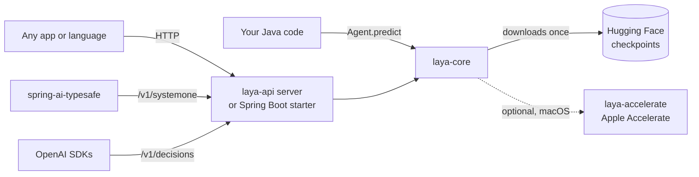

<div align="center">

# 🧭 laya-java

### Ask a question about some text. Get a probability back. In milliseconds. In pure Java.

[](https://central.sonatype.com/artifact/io.github.apscot/laya-core)
[](https://github.com/apscot/laya-java/actions/workflows/ci.yml)
[](LICENSE)


[**Quick taste**](#-quick-taste) · [**Pick your adventure**](#-pick-your-adventure) · [**Cookbook**](#-cookbook) · [**FAQ**](#-faq) · [**Limits**](#-the-honest-limitations-section)

</div>

---

**laya-java** runs [Laya](https://github.com/NandhaKishorM/laya) *typed-decision* models inside your JVM. No Python sidecar, no PyTorch, no GPU server, no per-token bill.

Laya is **not a chat model**. It never writes a paragraph. You give it some text and a question, it does one forward pass, and it answers with numbers:

| 🎯 You ask | 🧠 Laya answers |
|---|---|
| *"Does the customer want money back?"* (yes/no) | `0.84` |
| *"Which team: billing or technical?"* (choice) | `billing` 92 % · `technical` 8 % |
| *"How frustrated is this person? Calm / Frustrated / Very angry"* (score) | `1.09` → mostly *Frustrated*, a touch of *Very angry* |

Zero output tokens. Same input → same answer. Perfect for **routing, triage, moderation, guardrails, ranking and scoring** where asking an LLM would be slow, pricey and a little too creative.

> ⚠️ **Independent port.** laya-java is not an official release of Convai Innovations or the Laya project. Model weights are *not* bundled: they download from Hugging Face on first use under their own Apache-2.0 license.

---

## ⚡ Quick taste

```java
try (Agent agent = Agent.load("aac6fef/laya-mlx")) {          // first run downloads ~800 MB, once
    var qs = new LinkedHashMap<String, Question>();
    qs.put("dept",    Question.choice("Which team should handle this?", List.of("billing", "technical", "sales")));
    qs.put("urgent",  Question.noul("Does this convey urgency?", null));
    qs.put("mood",    Question.score("How frustrated is the customer?", List.of("Calm", "Frustrated", "Very angry")));

    var result = agent.predict("Help! My payouts have been failing for 3 days.", qs);
    // dept  → billing (89 %)    urgent → 0.74    mood → 1.09
}
```

Or skip the code and use HTTP:

```bash
curl -s localhost:8080/v1/decisions -H 'content-type: application/json' -d '{
  "model": "laya",
  "input": "I was billed twice, please refund.",
  "questions": [{"type":"predicate","name":"refund","instructions":"Does the customer want money back?"}]
}'
# → {"object":"decision","answers":[{"name":"refund","type":"predicate","probability":0.8436}], ...}
```

---

## 🗺️ How it fits together



---

## 🧰 Pick your adventure

Seven artifacts, all on Maven Central under `io.github.apscot`, all at version **0.1.0**. Use the BOM and you never have to repeat the version.

| I want to… | Use | Jump to |
|---|---|---|
| Call Laya from Java code, no server | `laya-core` | [↓](#-laya-core--the-engine) |
| Make it faster on my Mac | `laya-accelerate` | [↓](#-laya-accelerate--turbo-for-macs) |
| Add a Laya HTTP endpoint to my Spring Boot app | `laya-spring-boot-starter` | [↓](#-laya-spring-boot-starter--one-dependency-live-endpoint) |
| Run Laya as a standalone server (any language can call it) | `laya-api` | [↓](#-laya-api--the-protocol-layer-and-a-tiny-server) |
| Call a Laya/Jev server from Java | `laya-client` | [↓](#-laya-client--the-tiny-client) |
| Start/stop a local Laya in my Gradle build and tests | `laya-gradle-plugin` | [↓](#-laya-gradle-plugin--servers-on-demand) |
| Keep all the versions aligned | `laya-bom` | [↓](#-laya-bom--version-alignment) |

> **Needs:** JDK 17+ (that's it). About 2.5 GB of free memory for the English model. Internet on first run to fetch the weights.

### 📦 Install snippets, and the BOM

Every artifact section below shows **Gradle (Kotlin and Groovy) and Maven** snippets with the version written out, so each one works on its own.

Using several Laya artifacts? Import the BOM once and drop the versions: see [laya-bom](#-laya-bom--version-alignment).

---

## 🔬 laya-core — the engine

The heart of the project: tokenizer, ModernBERT encoder, decision heads, calibration. No dependencies at all.

**Gradle (Kotlin DSL)**
```kotlin
implementation("io.github.apscot:laya-core:0.1.0")
```

**Gradle (Groovy DSL)**
```groovy
implementation 'io.github.apscot:laya-core:0.1.0'
```

**Maven**
```xml
<dependency>
  <groupId>io.github.apscot</groupId>
  <artifactId>laya-core</artifactId>
  <version>0.1.0</version>
</dependency>
```

```java
import io.github.apscot.laya.core.Agent;
import io.github.apscot.laya.core.Question;

try (Agent agent = Agent.load("aac6fef/laya-mlx")) {
    Map<String, Object> result = agent.predict(state, questions);
}
```

**The three question types**

```java
Question.noul("Does the customer ask for a refund?", null);                       // yes/no → probability
Question.choice("Which team?", List.of("billing", "technical", "sales"));         // pick one
Question.choice("Which team?", Map.of("billing", "invoices, refunds",             // …with descriptions
                                      "technical", "bugs and outages"));
Question.score("How urgent is this?", List.of("not urgent", "soon", "critical")); // ordered scale
```

**What goes in:** the *state* is the thing being judged: a string, a JSON-like `Map`/`List`, or a chat history (a list of messages). Every question is evaluated independently against the same state.

**Checkpoints** (`Agent.load(...)` takes a Hugging Face id or a local folder):

| Model | Id | Best for |
|---|---|---|
| English | `aac6fef/laya-mlx` | English text |
| Multilingual | `aac6fef/laya-multilingual-mlx` | Everything else (中文, Русский, Español…) |
| Typed decisions | `aac6fef/laya-typed-decisions-mlx` | Upstream's typed-decisions workflows (1,024-token context) |

Weights are cached in `~/.cache/laya` (set `LAYA_CACHE` to move it). Load the `Agent` **once** and reuse it (loading is the slow part).

<details>
<summary><b>What does <code>result</code> look like?</b></summary>

```json
{
  "model": "laya-rl-agent",
  "answers": {
    "dept":   { "type": "choice", "choice": "billing",
                "probabilities": { "billing": 0.8914, "technical": 0.069, "sales": 0.0396 },
                "confidence": 0.6224, "answer_confidence": 0.8914 },
    "urgent": { "type": "noul", "noul": 0.7419, "confidence": 0.7419 },
    "mood":   { "type": "score", "score": 1.0889,
                "legend": { "0": "Calm", "1": "Frustrated", "2": "Very angry" },
                "probabilities": { "0": 0.0317, "1": 0.8477, "2": 0.1206 } }
  },
  "usage": { "input_tokens": 118, "output_tokens": 0, "truncated": false }
}
```
</details>

---

## 🍎 laya-accelerate — turbo for Macs

Drop-in speed-up on macOS. It calls Apple's built-in Accelerate library (`cblas_sgemm`) through JNA; no native code to build.

**Gradle (Kotlin DSL)**
```kotlin
runtimeOnly("io.github.apscot:laya-accelerate:0.1.0")
```

**Gradle (Groovy DSL)**
```groovy
runtimeOnly 'io.github.apscot:laya-accelerate:0.1.0'
```

**Maven**
```xml
<dependency>
  <groupId>io.github.apscot</groupId>
  <artifactId>laya-accelerate</artifactId>
  <version>0.1.0</version>
  <scope>runtime</scope>
</dependency>
```

That is the whole setup. `laya-core` finds it automatically. On Linux and Windows it quietly steps aside.

| Backend | Median, 31-token question (M5) |
|---|---|
| `laya-accelerate` | **~60 ms** |
| Portable Java (Vector API) | ~186 ms |

Switch it off for comparison: `LAYA_BACKEND=portable`. Seeing `WARNING … jna … restricted method`? That's a harmless JDK notice about native access.

---

## 🌱 laya-spring-boot-starter — one dependency, live endpoint

Add the starter and your Spring Boot 3 app serves the model. Nothing else to write.

**Gradle (Kotlin DSL)**
```kotlin
implementation("io.github.apscot:laya-spring-boot-starter:0.1.0")
```

**Gradle (Groovy DSL)**
```groovy
implementation 'io.github.apscot:laya-spring-boot-starter:0.1.0'
```

**Maven**
```xml
<dependency>
  <groupId>io.github.apscot</groupId>
  <artifactId>laya-spring-boot-starter</artifactId>
  <version>0.1.0</version>
</dependency>
```

The starter targets **Spring Boot 3.x** (tested with 3.4) and already brings in `spring-boot-starter-web` and, at runtime, `laya-accelerate`.

```properties
# application.properties (all optional)
laya.preload=true            # load the model at startup instead of on first request
laya.api-key=secret          # require "Authorization: Bearer secret" on /v1/*
```

Run your app and you get:

| Endpoint | Speaks |
|---|---|
| `POST /v1/decisions` | **OpenAI Decisions API** |
| `POST /v1/systemone` | **Jev / System One** (what Spring AI TypeSafe uses) |
| `GET /v1/models` | model list |

<details>
<summary><b>All properties</b></summary>

| Property | Meaning | Default |
|---|---|---|
| `laya.models.<name>` | Hugging Face id or folder for a model name | the three published checkpoints |
| `laya.default-model` | Model used when no name matches | `english` |
| `laya.api-key` | Bearer token for `/v1/*` | none |
| `laya.preload` | Load the default model at startup | `false` |
| `laya.endpoint.enabled` | Expose the endpoints | `true` |
| `laya.endpoint.base-path` | Prefix for the paths | empty |
</details>

**JVM flags** (`--add-modules=jdk.incubator.vector -Xmx3g`) give you speed and headroom:

```kotlin
// Gradle
tasks.bootRun { jvmArgs("--add-modules=jdk.incubator.vector", "-Xmx3g") }
```
```xml
<!-- Maven -->
<plugin>
  <groupId>org.springframework.boot</groupId>
  <artifactId>spring-boot-maven-plugin</artifactId>
  <configuration>
    <jvmArguments>--add-modules=jdk.incubator.vector -Xmx3g</jvmArguments>
  </configuration>
</plugin>
```
For a packaged jar: `java --add-modules=jdk.incubator.vector -Xmx3g -jar app.jar` (or `JAVA_TOOL_OPTIONS="--add-modules=jdk.incubator.vector"`; note the `=`).

**🤔 "Why is there a `model` field? Laya *is* the model."** Correct! OpenAI's and Jev's request formats require the field, so we accept it. Use `english`, `multilingual` or `typed-decisions` to pick a checkpoint. Any other value (`laya`, `gpt-6-luna`, `banana`) means *"you choose"*: the server routes by the language of the text.

**🔑 "Do I need an API key?"** No. It's off unless you set `laya.api-key`. (One exception: the Spring AI TypeSafe *client* refuses an empty key, so give it any string.)

---

## 🌐 laya-api — the protocol layer and a tiny server

The brains behind the endpoints, with **no Spring dependency**. Use it to run a standalone server, or to bolt Laya onto any other framework (Quarkus, Micronaut, Javalin, Vert.x…).

**Gradle (Kotlin DSL)**
```kotlin
implementation("io.github.apscot:laya-api:0.1.0")
runtimeOnly("io.github.apscot:laya-accelerate:0.1.0")
```

**Gradle (Groovy DSL)**
```groovy
implementation 'io.github.apscot:laya-api:0.1.0'
runtimeOnly 'io.github.apscot:laya-accelerate:0.1.0'
```

**Maven**
```xml
<dependency>
  <groupId>io.github.apscot</groupId>
  <artifactId>laya-api</artifactId>
  <version>0.1.0</version>
</dependency>
<dependency>
  <groupId>io.github.apscot</groupId>
  <artifactId>laya-accelerate</artifactId>
  <version>0.1.0</version>
  <scope>runtime</scope>
</dependency>
```

(`laya-accelerate` is optional.)

**A standalone server in six lines**

```java
import io.github.apscot.laya.api.*;

public class Server {
    public static void main(String[] args) throws Exception {
        ModelRegistry models = ModelRegistry.defaults();               // english / multilingual / typed-decisions
        LayaHttpServer server = new LayaHttpServer(models, "0.0.0.0", 8000, /* apiKey */ null);
        server.start();                                                // GET /health, POST /v1/decisions, /v1/systemone
    }
}
```

Or configure it with environment variables and run `LayaHttpServer` directly:

| Variable | Meaning | Default |
|---|---|---|
| `LAYA_PORT` | listen port | `8000` |
| `LAYA_HOST` | bind address | `127.0.0.1` |
| `LAYA_API_KEY` | require a Bearer token | none |
| `LAYA_MODELS` | comma list, e.g. `english,multilingual` | all three |
| `LAYA_PRELOAD` | `1` to load at startup | off |

**Bring your own framework:** call the handlers with parsed JSON maps and return the map they give you.

```java
var registry = ModelRegistry.defaults();
Map<String, Object> reply = new DecisionsApi(registry).handle(requestBodyAsMap);   // OpenAI shape
Map<String, Object> jev   = new SystemOneApi(registry).handle(requestBodyAsMap);   // Jev shape
// LayaApiException carries the right HTTP status and error body for bad requests
```

Limits (same as the upstream server): 64 questions, 50,000 characters of state, 2 MB body.

---

## 📡 laya-client — the tiny client

Zero dependencies beyond the JDK. Talks to laya-java, the upstream Python `laya-serve`, or any Jev-compatible endpoint.

**Gradle (Kotlin DSL)**
```kotlin
implementation("io.github.apscot:laya-client:0.1.0")
```

**Gradle (Groovy DSL)**
```groovy
implementation 'io.github.apscot:laya-client:0.1.0'
```

**Maven**
```xml
<dependency>
  <groupId>io.github.apscot</groupId>
  <artifactId>laya-client</artifactId>
  <version>0.1.0</version>
</dependency>
```

```java
LayaClient client = new LayaClient("http://localhost:8080", /* apiKey or null */ null);

Map<String, Question> qs = new LinkedHashMap<>();
qs.put("refund", Question.noul("Does the customer want money back?", null));
qs.put("dept",   Question.choice("Which team?", List.of("billing", "technical")));

Map<String, Object> r = client.systemOne("I was billed twice, please refund.", qs);
double refund = LayaClient.noul(r, "refund");       // 0.84
String dept   = LayaClient.choice(r, "dept");       // "billing"
```

Also: `client.decisions(Map)` for the OpenAI format, `client.models()`, and `LayaClient.score(r, "id")`. Errors raise `LayaClient.ApiException` with `.status` and `.body`.

---

## 🔌 laya-gradle-plugin — servers on demand

Start a real Laya server for local development and integration tests, then shut it down.

The plugin is published to Maven Central, so tell Gradle to look there. In `settings.gradle.kts`:

```kotlin
pluginManagement {
    repositories {
        mavenCentral()
        gradlePluginPortal()
    }
}
```

**Gradle (Kotlin DSL)** — `build.gradle.kts`
```kotlin
plugins {
    java
    id("io.github.apscot.laya") version "0.1.0"
}

laya {
    model.set("aac6fef/laya-mlx")     // Hugging Face id or local folder
    port.set(8002)
    testIntegration.set(true)         // start before `test`, stop after, pass -Dlaya.base-url
}
```

**Gradle (Groovy DSL)** — `build.gradle` (and in `settings.gradle`: `pluginManagement { repositories { mavenCentral(); gradlePluginPortal() } }`)
```groovy
plugins {
    id 'java'
    id 'io.github.apscot.laya' version '0.1.0'
}

laya {
    model = 'aac6fef/laya-mlx'
    port = 8002
    testIntegration = true
}
```

**Maven:** this is a Gradle plugin, so there is no Maven plugin. In a Maven build, start the server from your tests with `laya-api` (test scope):
```xml
<dependency>
  <groupId>io.github.apscot</groupId>
  <artifactId>laya-api</artifactId>
  <version>0.1.0</version>
  <scope>test</scope>
</dependency>
```
```java
@BeforeAll static void start() throws Exception {
    server = new LayaHttpServer(ModelRegistry.defaults(), "127.0.0.1", 8002, null);
    server.start();
}
@AfterAll static void stop() { server.close(); }
```
Run the tests with `--add-modules=jdk.incubator.vector` in the Surefire `argLine` for speed.

```bash
./gradlew layaServe     # starts it in the background and waits until healthy
curl localhost:8002/health
./gradlew layaStop
```

With `testIntegration`, your tests can read the address:

```java
String base = System.getProperty("laya.base-url");        // http://127.0.0.1:8002
```

Server logs land in `build/laya/server.log`. Other knobs: `apiKey`, `maxHeap` (default `3g`), `runtimeVersion`.

---

## 🧱 laya-bom — version alignment

A Bill of Materials so every Laya artifact stays on the same version.

Import it once, then add any Laya artifact **without a version**.

**Gradle (Kotlin DSL)**
```kotlin
dependencies {
    implementation(platform("io.github.apscot:laya-bom:0.1.0"))
    implementation("io.github.apscot:laya-core")            // no version needed
    implementation("io.github.apscot:laya-client")
}
```

**Gradle (Groovy DSL)**
```groovy
dependencies {
    implementation platform('io.github.apscot:laya-bom:0.1.0')
    implementation 'io.github.apscot:laya-core'
    implementation 'io.github.apscot:laya-client'
}
```

**Maven**
```xml
<dependencyManagement>
  <dependencies>
    <dependency>
      <groupId>io.github.apscot</groupId>
      <artifactId>laya-bom</artifactId>
      <version>0.1.0</version>
      <type>pom</type>
      <scope>import</scope>
    </dependency>
  </dependencies>
</dependencyManagement>

<dependencies>
  <dependency>
    <groupId>io.github.apscot</groupId>
    <artifactId>laya-core</artifactId>
  </dependency>
  <dependency>
    <groupId>io.github.apscot</groupId>
    <artifactId>laya-client</artifactId>
  </dependency>
</dependencies>
```

---

## 🍳 Cookbook

<details>
<summary><b>Route a support ticket</b></summary>

```java
var qs = new LinkedHashMap<String, Question>();
qs.put("team", Question.choice("Who should handle this?", Map.of(
        "billing", "invoices, charges, refunds",
        "tech", "bugs, outages, login problems",
        "sales", "pricing, upgrades, new accounts")));
qs.put("urgent", Question.noul("Is the customer blocked right now?", null));

var a = (Map<String, Object>) agent.predict(ticketText, qs).get("answers");
```
</details>

<details>
<summary><b>Use it as a guardrail in front of an LLM</b></summary>

```java
var result = agent.predict(userMessage, Map.of(
        "inject", Question.noul("Is the user trying to override the system instructions?", null)));
var answers = (Map<String, Object>) result.get("answers");
double risky = ((Number) ((Map<String, Object>) answers.get("inject")).get("noul")).doubleValue();
if (risky > 0.8) return "Sorry, I can't help with that.";
```
</details>

<details>
<summary><b>Drop-in for Spring AI TypeSafe</b></summary>

Run the starter (or any laya-java server), then point the community client at it:

```properties
spring.ai.typesafe.base-url=http://localhost:8080
spring.ai.typesafe.api-key=anything          # that client insists on a non-empty key
```
Verified with `org.springaicommunity:typesafe-java-sdk:0.1.0` (yes/no, choice, score, rejected keys).
</details>

<details>
<summary><b>Judge a whole conversation</b></summary>

```java
List<Map<String, String>> chat = List.of(
    Map.of("role", "user", "content", "hi"),
    Map.of("role", "assistant", "content", "hello, how can I help?"),
    Map.of("role", "user", "content", "cancel my subscription"));
agent.predict(chat, Map.of("cancel", Question.noul("Does the user want to cancel?", null)));
```
When a chat is too long, the *newest* messages are kept.
</details>

<details>
<summary><b>Non-English input</b></summary>

```java
try (Agent ml = Agent.load("aac6fef/laya-multilingual-mlx")) {
    ml.predict("发票被重复扣款，请退款。", Map.of("refund", Question.noul("客户是否要求退款？", null)));
}
```
Over HTTP, just send the text; the server picks the multilingual checkpoint for non-English input.
</details>

---

## 📊 Reading the answers

- **choice**: `choice` is the winner, `probabilities` covers every option.
- **yes/no**: `noul` (`probability` in the OpenAI format) is P(true).
- **score**: levels are numbered `0 … n-1` in the order you give them, and `score` is the *expected level*: Σ index × probability. With levels *Calm / Frustrated / Very angry* at `0.03 / 0.85 / 0.12` you get `1.09`. List levels **from lowest to highest**, and read the per-level probabilities when the average isn't enough (a score of 1.0 can be "certainly level 1" or "half level 0, half level 2").
- **`answer_confidence`** = probability of the top answer. **`confidence`** = how peaked the whole distribution is (1 certain, 0 evenly spread). Different scales; don't share a threshold.

Probabilities are temperature-calibrated using values from the checkpoint, but they are **not** guaranteed to match real-world frequencies. Measure your threshold on labelled examples from your own data before shipping it.

---

## ⏱️ Performance

Apple M5 (10 cores), JDK 21, English checkpoint, warm, 31-token question:

| Backend | Median |
|---|---|
| `laya-accelerate` (Apple Accelerate) | ~60 ms |
| Portable Java (Vector API) | ~186 ms |
| Python / MLX on a GPU (published, M3 Max) | ~13 ms |

A 512-token input takes about 1 s with Accelerate. laya-java is slower than MLX on a GPU; what you get in return is *runs anywhere a JVM runs*, with no Python in your deployment.

**Make it quick:** load the `Agent` once · add `--add-modules=jdk.incubator.vector` · on Macs add `laya-accelerate` · preload in servers.

---

## ❓ FAQ

**Is this an LLM?** No. It's a small encoder model with decision heads. It scores; it doesn't write.

**Does it need a GPU or Python?** Neither. It's plain Java (optionally using Apple's CPU math library on Macs).

**Is it deterministic?** Yes. Same input, same model, same numbers.

**How big is it?** About 800 MB on disk (English) and ~2.5 GB of memory while running.

**Is it production-ready?** It's a `0.x` release: tested against the Python reference on all three checkpoints, but young. Validate on your own data and pin the version.

**How do I know the numbers are right?** Tokenizer ids, scores and answers are compared with the Python [`laya-mlx`](https://github.com/mizorewww/laya-mlx) reference on a fixed set of cases for every checkpoint. That shows agreement with the reference, not accuracy on every possible input.

**Can I use my own fine-tuned Laya checkpoint?** If it follows the same layout (`model.safetensors`, `rl_agent_config.json`, `encoder/config.json`, `tokenizer/`), point `Agent.load("/path/to/dir")` or `laya.models.mine=/path/to/dir` at it.

---

## 🚧 The honest limitations section

- Checkpoints using the "parallel" option layout aren't supported (none are published yet).
- No image input: `/v1/decisions` returns an error for image parts.
- Not ported from the Python library: `predict_shortlist`, `predict_tournament`, `min_confidence` gating, email presets, streaming.
- Language routing between the English and multilingual checkpoints is a simple heuristic, not the full upstream detector.
- The `/v1/decisions` response follows OpenAI's public docs and published examples. If you depend on exact field names, check them against the OpenAI SDK you use.
- Like the original, Laya is weaker on criteria needing world knowledge. Test it on your data.

---

## 🛠️ Building from source

```bash
git clone https://github.com/apscot/laya-java.git
cd laya-java
gradle build
```

Tests that need model checkpoints are skipped unless `LAYA_MODEL_DIR`, `LAYA_MODEL_DIR_MULTILINGUAL` and `LAYA_MODEL_DIR_TYPED` point at local checkpoints. A Python script in `tools/` regenerates test fixtures from the reference implementation; it is a development tool and is not part of any published artifact. 

Issues and pull requests are welcome.

---

## 📜 License and thanks

Apache License 2.0: see [LICENSE](LICENSE) and [NOTICE](NOTICE).

Built on the shoulders of [Laya](https://github.com/NandhaKishorM/laya) by Convai Innovations and contributors, the [laya-mlx](https://github.com/mizorewww/laya-mlx) port (our numerical reference), and the ModernBERT architecture. Thank you all. 💙
